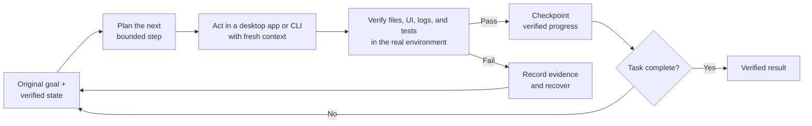
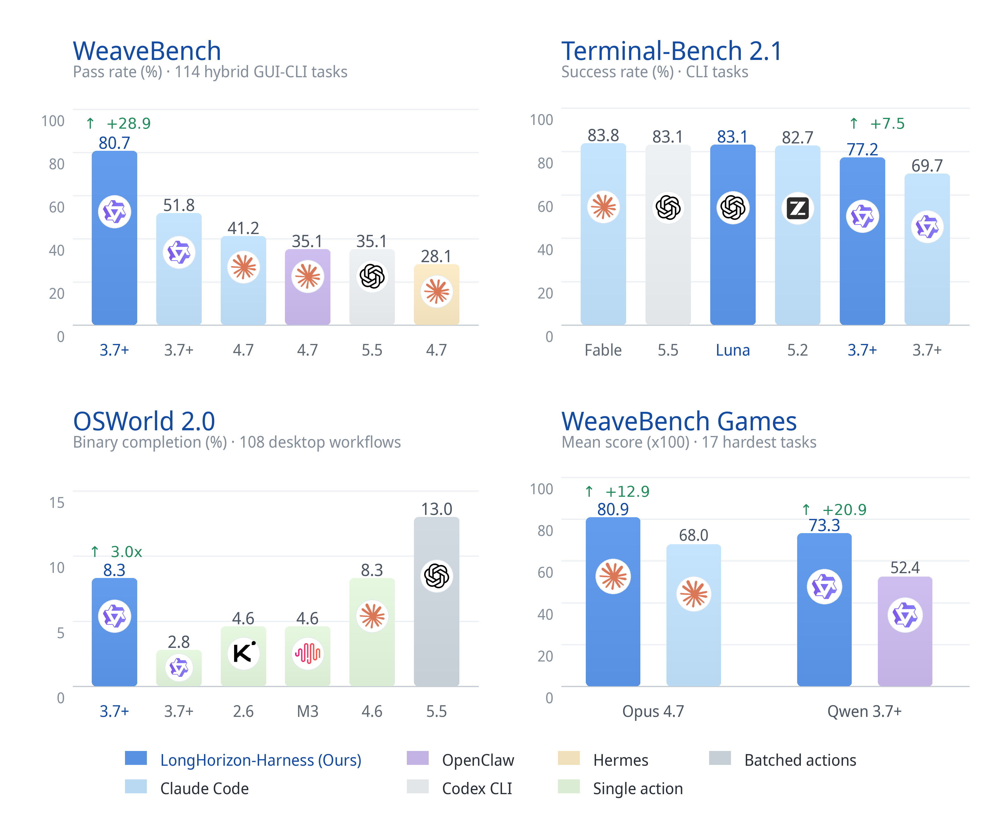

<div align="center">

# LongHorizon-Harness

### コンピューター操作エージェントのための Loop Engineering

**Claude Code、Codex、OpenCode、DeepSeek Harness に一度だけ目標を伝えれば、デスクトップアプリとターミナルをまたいで、何十時間でも作業を続けさせられます。**

**計画 → 実行 → 検証 → チェックポイントまたは復旧 → 繰り返し。作業が本当に終わるまで続けます。**

<p align="center">
<a href="https://lh-harness.pages.dev"></a>
<a href="https://arxiv.org/abs/2608.01964"></a>
<a href="https://github.com/AMAP-ML/LongHorizon-Harness"></a>

<a href="https://huggingface.co/papers/2608.01964"></a>
<a href="./LICENSE"></a>
</p>

[](https://www.python.org/)
[](#あらゆるモデルあらゆるエージェントバックエンド)
[](#数百の実際のタスク測定された効果)

[Usage](#コマンド-1-つですべてを可視化) · [The Loop](#実際のコンピューター環境のための-loop-engineering) · [Computer Use](#デスクトップアプリと-cliひとつの連続したタスク) · [Results](#数百の実際のタスク測定された効果) · [Project Website](https://lh-harness.pages.dev) · [English](README.md) · [简体中文](README.zh-CN.md) · 日本語

<br>


</div>

> **1 ラウンドでエージェントに何ができるかを決めるのはモデルです。LongHorizon-Harness は、その周りのループを設計します：次に何をするか、実際のコンピューター上で結果をどう検証するか、どの進捗を保存するか、そして失敗やコンテキストのリフレッシュのあとでどう続けるか。**

**Claude Code、Codex、OpenCode、DeepSeek Harness のための Loop Engineering のシステムです。コマンド 1 つでインストールでき、すぐに実行できます。**

LongHorizon-Harness は、既存のエージェントを、長時間動作するコンピューター操作のシステムに変えます。デスクトップアプリとターミナルの CLI をまたいで、目標と検証済みの状態を継続的に取り戻し、次の範囲を区切ったステップを選び、新しいコンテキストでそれを実行し、実際の結果を確認したうえで、受け入れられた進捗をチェックポイントとして保存するか、失敗の根拠を次のラウンドに引き渡します。新しいモデルを学習させたり、既存のエージェントを置き換えたりするのではなく、その周りに永続的な実行ループを提供します。

## ✨ ニュース

- **[v0.1.8 · 2026-10-21]** 過去の実行を再開したあとの承認、Markdown 形式の Manager のルート、Claude Code の MCP の分離、UTF-8 以外の CLI/DeepSeek の出力に関する問題を修正しました。返答の締めくくりが遅い場合のために `--final-response-timeout` を追加しました。アップグレードの詳細と、現在の Windows での制限については[リリースノート](https://github.com/AMAP-ML/LongHorizon-Harness/releases/tag/v0.1.8)をご覧ください。
- **[v0.1.7 · 2026-08-20]** 実行が終わっても、そこで行き止まりではなくなりました：ワークベンチが会話になりました。返答を読んでフォローアップを入力すると、実行はゼロから計画し直すのではなく、自身のラウンドの台帳の続きから再開します。ラウンドの途中で送ったメッセージは、すぐ次のラウンドが引き受けるため、停止して続行しても失われることはありません。また、すべてのロールに `--reasoning-effort` を追加しました（個別に上書きするには `--manager-reasoning-effort` などを使います）。これは、それを公開しているバックエンドに転送されます。トランスクリプトは厳密に時系列順に表示されるようになり、穏やかな停止は、ワーカーがそれを無視した場合にのみ強制停止に切り替わります。
- **[v0.1.6 · 2026-08-15]** [OpenCode](https://github.com/anomalyco/opencode) CLI への対応を追加しました。LongHorizon-Harness は、`opencode run prompt` を `--agent opencode` として実行できるようになりました。ロール単位の読み取り/書き込み権限、OpenCode の API エンドポイントの上書き、正規化された JSON の結果、CLI/設定/doctor との統合に対応しています。Web ワークベンチでは、ロールごとに OpenCode Harness とそのモデルを個別に選べます。
- **[v0.1.5 · 2026-08-14]** [DeepSeek Harness](https://github.com/deepseek-ai/deepseek-harness) CLI へのフェーズ 1 の対応を追加しました。LongHorizon-Harness は、`dsh --profile headless` を `--agent deepseek_harness` として実行できるようになりました。独立した `DSH_HOME`、ロール単位の読み取り/書き込み権限、DeepSeek の API エンドポイントの上書き、正規化された JSONL の結果、CLI/設定/doctor との統合に対応しています。Web ワークベンチでは、ロールごとに DeepSeek Harness とそのモデルを個別に選べます。GUI のコンピューター操作と MCP への対応は、後のフェーズで追加される予定です。[CLI のセットアップ](#5-またはコマンドラインからタスクを実行する)をご覧ください。
- **[v0.1.4 · 2026-08-11]** 新しいダッシュボードが登場しました：ブラウザからすべてを操作できる React/FastAPI のワークベンチです。タスクを開始し、ロールごとにバックエンドとモデルを選び、承認に応え、実行の途中で指示を送り、実行を停止または再開できます。`lh-harness web` で起動します。[ブラウザでタスクを実行する](#4-ブラウザでタスクを実行する推奨)をご覧ください。
- **[2026-08-10]** Terminal-Bench 2.1 の評価を追加しました。
- **[v0.1.3 · 2026-08-07]** すべての実行の最後に、検証済みの状態だけをもとにタスクに答える、平易な言葉の返答が付くようになりました。タスクはデフォルトで起動したディレクトリを対象に動作し、コンソールには各ラウンドの進行がリアルタイムで報告されます。
- **[2026-08-06]** LongHorizon-Harness が [Hugging Face Daily Papers の週間ランキング](https://huggingface.co/papers/week/2026-W32)で **1 位** になりました。
- **[v0.1.2 · 2026-08-06]** コンピューター操作プラグインの統一的な管理、Auditor の読み取り専用チェックとロールの分離の強化、確実なプロセスのクリーンアップ、`doctor` の診断の拡充を追加しました。[コンピューター操作プラグインを管理する](#コンピューター操作プラグインを管理する)をご覧ください。

> 🚀 急ピッチで改良を続けています。今後にご期待ください！

## 動画デモ

https://github.com/user-attachments/assets/ca8b77ce-9220-4d85-a272-b346009b2454

<p align="center"><a href="assets/promotional_video_1440p.mp4"><strong>プロモーション動画を開く（1440p MP4）</strong></a></p>

## 実際のコンピューター環境のための Loop Engineering。

LongHorizon-Harness には、達成したい結果を伝えてください。残りの作業を範囲を区切ったステップに繰り返し落とし込み、そのステップを適切なコンピューターの画面で実行し、実際に何が起きたかを確認して、検証済みの結果を次のラウンドに引き継ぎます。



これが **Loop Engineering** です：単一のターンのためのプロンプトだけでなく、エージェントの周りの実行、検証、修正、復旧のループを設計することです。

### 1 つのループ。3 つの明確な責務。

ロールはループの中の実装上の境界であり、3 つのエージェントがそれぞれ独自にタスクを膨らませていくわけではありません。

| ループの責務 | ロール | 担うもの |
|---|---|---|
| 🧭 **状態と次のステップ** | **Manager** | 元の目標、検証済みの進捗、失敗の根拠、残りの作業から、毎ラウンドを組み立て直します |
| ⚡ **アクション** | **Executor** | 新しいコンテキストで開始し、デスクトップアプリまたは CLI で明確に定義された 1 つのステップを完了します |
| 🔍 **グラウンドトゥルース** | **Auditor** | Executor の主張を信じるのではなく、実際のファイル、インターフェース、ログ、テストを独立して検査します |

独立した検証を通過した結果だけが、信頼できるタスクの状態になります。却下された結果は根拠として残りますが、進捗にはなりません。コンテキストがリフレッシュされたとき、アクションが失敗したとき、成果物が検査を通過しなかったときは、次のラウンドが元の目標と最後に検証されたチェックポイントから始まり、残りの作業を続けます。

## デスクトップアプリと CLI。ひとつの連続したタスク。

LongHorizon-Harness は、GUI と CLI の両方のワークフローに対応しています。

| 🖥️ デスクトップを操作する | ⌨️ ターミナルで作業する |
|---|---|
| 🌐 クリック、入力、スクロール、ブラウジング | 💻 コードの作成と修正 |
| 📊 スプレッドシートの操作 | ▶️ コマンドとスクリプトの実行 |
| 📄 ドキュメントの編集 | 📦 依存関係と環境のインストール |
| 🎨 デザインソフトウェアの使用 | 🔧 システムの設定とデバッグ |
| 🧊 3D ツールの操作 | 📁 ファイルとデータの処理 |

1 つのタスクを、ブラウザで始め、データ処理のためにコマンドラインに移り、成果物を作るためにデスクトップのソフトウェアで続け、検証やデバッグのためにターミナルに戻る、といった形で進められます。目標、進捗、根拠は、最初から最後まで同じ状態管理のシステムのもとに保たれます。

## あらゆるモデル。あらゆるエージェントバックエンド。

LongHorizon-Harness は、特定のモデルやエージェントのバックエンドに縛られません。既存のモデルとエージェントは、元のワークフローを変えることなく、設定によって接続できます。

| | レイヤー | 対応している選択肢 |
|---|---|---|
| 🧠 | **モデル** | Claude、GPT、Qwen、およびエージェントのバックエンドが公開しているその他のモデル |
| 🤖 | **エージェントのバックエンド** | Claude Code、Codex CLI、OpenCode、DeepSeek Harness（`dsh`。フェーズ 1 では CLI のみ）、カスタムの `AgentAdapter` の実装 |
| 🎛️ | **ロールの割り当て** | Manager、Executor、Auditor は、それぞれ異なるモデルやバックエンドを使えます |
| 🖥️ | **実行環境** | ローカル。プラグイン可能な `Environment` プロトコルを備えています |

軽量な `AgentAdapter` が各エージェントのネイティブな実行ループを保ち、LongHorizon-Harness はその周りで、ロールの境界、検証済みのタスクの状態、ラウンドをまたいだ進捗を調整します。

3 つのロールすべてに 1 つのモデルを使うことも、品質、速度、コストのバランスを取るために異なるモデルやバックエンドを組み合わせることもできます。

## 数百の実際のタスク。測定された効果。

LongHorizon-Harness は、厳選された一握りの成功例だけで実演しているわけではありません。

GUI、CLI、その混在したコンピューター環境にまたがる、数百の複雑なタスクで実行しました：

| タスクの領域 | タスクの内容 |
|---|---|
| 🌐 **Web フロントエンド** | ブラウザの操作、開発者ツール、コードの変更を通じた、Web サイトや Web アプリケーションの開発、修正、検証 |
| 📊 **データ分析と可視化** | データの処理、グラフやダッシュボードの作成、分析結果とビジュアルの成果物の確認 |
| 🛠️ **運用とデバッグ** | ログ、ネットワーク、パフォーマンス、サービスの障害の調査、システムの設定、診断、修復 |
| 🎨 **デザインと画像処理** | ビジュアルアセットの編集、デザインの参考資料への一致、画像の処理、最終的なビジュアルの品質の検証 |
| 🎮 **ゲームとインタラクション** | ゲームやインタラクティブなアプリケーションの構築、操作、デバッグ、インタラクションのロジックと実行時の動作の確認 |
| 📄 **ドキュメントとプレゼンテーション** | 内容、書式、参照、レイアウト、最終的な納品を含む、ドキュメントとスライドの編集 |
| 🧊 **空間推論** | 空間的な関係、幾何、正確な配置、3D の操作を伴うタスクの完了 |
| 🖥️ **デスクトップとシステム設定** | 複数のアプリケーションにまたがるワークフローでの、デスクトップアプリケーション、ファイル、システム設定の操作 |
| 🔬 **研究と教育** | 文献調査、課題、教材、フォーム、研究支援のワークフローの完了 |
| 🎬 **クリエイティブな制作** | ツール間でアセットを調整しながらの、プレゼンテーション、動画、音声、その他のメディアの制作 |
| ⚙️ **エンジニアリングとコンピューティング** | CAD、EDA、科学技術ソフトウェア、開発ツール、クラウドや DevOps のツールチェーンの使用 |
| 🎫 **個人向けサービス** | イベントのチケット、日常的なサービス、ゲーム、画像検索のワークフローの処理 |
| 🏛️ **行政とコンプライアンス** | オフィス、法務、ポリシーに関わるフォーム、組織、安全に配慮した提出のワークフローの完了 |
| 💼 **ビジネスと金融** | 市場分析、調達、ローン、営業、経費精算、アプリケーションをまたいだ企業のワークフローの処理 |
| 🏥 **ヘルスケア** | 医療の品質管理、保険、予防接種、構造化された健康関連のフォームのワークフローの完了 |

### 同じモデル。同じ実行バックエンド。変わるのはハーネスだけ。

<table>
<tr>
<td align="center" width="33%">
<h2>~50% → ~80%</h2>
<strong>GUI + CLI の完了率</strong><br>
<sub>WeaveBench</sub>
</td>
<td align="center" width="33%">
<h2>3×</h2>
<strong>デスクトップのタスクの完全な完了</strong><br>
<sub>OSWorld 2.0</sub>
</td>
<td align="center" width="33%">
<h2>69.7% → 77.2%</h2>
<strong>コード + CLI の成功率</strong><br>
<sub>Terminal-Bench 2.1 · トークン数 24% 削減</sub>
</td>
</tr>
</table>

<div align="center">

</div>

### 📊 ベンチマークの全結果と実験設定

| ベンチマーク | 指標 | Claude Code | **LongHorizon-Harness** | 向上 |
|---|---|:-:|:-:|:-:|
| **WeaveBench**（114 タスク） | PassRate | 51.8 | **80.7** | **+28.9** |
| **WeaveBench** | Overall | 0.702 | **0.835** | +0.133 |
| **OSWorld 2.0**（108 タスク） | Binary | 2.8 | **8.3** | **3.0×** |
| **OSWorld 2.0** | Partial | 21.5 | **35.2** | **+13.7** |
| **Terminal-Bench 2.1** | 成功率 | 69.7 | **77.2** | **+7.5** |

<sub>すべての行で、バックボーンに Qwen 3.7-Plus を、実行バックエンドに Claude Code を使っています。</sub>

結果の全表とケースの軌跡は、[LongHorizon-Harness のプロジェクトの Web サイト](https://lh-harness.pages.dev)でご覧いただけます。

## コマンド 1 つで、すべてを可視化。

### インストール

ステップ 1〜2 はマシンごとに 1 回、ステップ 3 はプロジェクトごとに 1 回です。その後は、ブラウザ（ステップ 4）またはコマンドライン（ステップ 5）からタスクを実行します。

#### 必要なもの

| | 用途 |
|---|---|
| [uv](https://docs.astral.sh/uv/getting-started/installation/) | 推奨される分離されたインストール。pip を使いたい場合は不要です。 |
| Python 3.10 以降 | ハーネスの実行。`uv tool install` は独自の Python を用意し、pip でのインストールはお使いの Python を使います。 |
| `PATH` 上のエージェントのランタイム 1 つ：[`codex`](https://github.com/openai/codex#installing-and-running-codex-cli)、[`claude`](https://docs.anthropic.com/en/docs/claude-code/getting-started)、[`opencode`](https://github.com/anomalyco/opencode)、または [`dsh`](https://github.com/deepseek-ai/deepseek-harness) | 実際に作業を実行します。ロールごとにバックエンドを組み合わせたい場合は、複数インストールしてください。 |
| [Node.js](https://nodejs.org) 20 以降 | npm で配布されているコンピューター操作プラグイン。DeepSeek Harness 自体は現在、Node.js `^22.19.0` または `>=24.0.0` が必要です。 |

> **プラットフォームの状況：** 現在テストしているプラットフォームは macOS です。ネイティブの Windows での実行は、v0.1.8 では POSIX 専用のコントロールバスとスーパーバイザーのプリミティブのためにブロックされています。WSL2 を使い、ハーネスとエージェントの CLI を Linux の中にインストールしてください。ネイティブの Windows への対応は [#70](https://github.com/AMAP-ML/LongHorizon-Harness/issues/70) で追跡しています。

上記のすべてを確認するには、いつでも `lh-harness doctor` を実行してください。[環境を確認する](#環境を確認する)をご覧ください。

#### 1. LongHorizon-Harness をインストールする

```bash
uv tool install lh-harness            # or: pip install lh-harness
```

あとでアップグレードするには、`uv tool upgrade lh-harness` または `pip install --upgrade lh-harness` を使います。

#### 2. コンピューター操作プラグインをインストールする

タスクで GUI をまったく扱わない場合は、このステップは不要です。そうでなければ、お使いのエージェントに合ったものをインストールしてください。デフォルトで有効になっているプラグインはなく、1 回インストールすればマシン上のすべてのプロジェクトで使えます。

Codex を使う場合：

```bash
lh-harness plugin install codex-computer-use
```

Claude Code を使う場合、または両方のエージェントを使う場合：

```bash
lh-harness plugin install open-computer-use
```

`codex-computer-use` は Codex CLI に同梱されている公式のプラグインで、Codex でのみ動作します。`open-computer-use` は npm で配布されており、Node.js 20 以上が必要で、両方のエージェントを動かせます。どちらも **macOS では手動で許可する必要がある** OS の権限が必要です。そのための手順、3 つ目の選択肢である `clawdcursor`、それぞれの接続方法については、[コンピューター操作プラグインを管理する](#コンピューター操作プラグインを管理する)をご覧ください。

#### 3. プロジェクトの設定を生成する

```bash
cd /path/to/your/project
lh-harness init
```

これにより `./.lh-harness/config.toml` が作成されます。既存のファイルは置き換えません。作り直すには `lh-harness init --force` を使ってください。ファイルを開いてデフォルトの値を調整します。すべてのフィールドは[設定リファレンス](#設定リファレンス)に記載されています。

#### 4. ブラウザでタスクを実行する（推奨）

```bash
lh-harness web --workspace-root .
```

これにより、`http://127.0.0.1:8799/` でワークベンチが開きます。すべての操作はそこで行えます：タスクの開始、ロールごとのバックエンドとモデルの選択、承認のリクエストへの応答、実行の途中での指示の送信、実行の停止または再開、そして実行が終わったあとのフォローアップの質問。フォローアップでは、同じ実行が、すでに完了したラウンドの続きから再開されます。`--workspace-root` は、そこで作成したタスクのデフォルトの作業ディレクトリを設定します。その他のオプションは[ダッシュボードのコマンド](#ダッシュボードのコマンド)に記載されています。

#### 5. またはコマンドラインからタスクを実行する

```bash
TASK="Inspect the current directory and summarize its files."
lh-harness run --task "${TASK}" --agent codex
```

`--agent` のような明示的な CLI の引数は、その実行に限り、`./.lh-harness/config.toml` の対応する値を上書きします。設定したデフォルトを使うには、引数を省略してください。

フェーズ 1 の DeepSeek Harness CLI のバックエンドを使うには、公式の npm パッケージをインストールし、DeepSeek の API キーを用意して、`deepseek_harness` を選択します：

```bash
npm install -g @deepseek-ai/dsh
# If your npm mirror has not synced the package:
# npm install -g @deepseek-ai/dsh --registry=https://registry.npmjs.org

dsh --version
export DEEPSEEK_API_KEY="sk-..."
# Optional for a private or compatible endpoint:
# export DEEPSEEK_BASE_URL="https://your-endpoint.example.com"

lh-harness doctor
lh-harness run --task @task.md --agent deepseek_harness \
  --model deepseek-v4-flash --no-dashboard
```

DeepSeek Harness をプロジェクトのデフォルトにするには、`./.lh-harness/config.toml` に次のように記述します：

```toml
[run]
agent = "deepseek_harness"
model = "deepseek-v4-flash"
dashboard = false
```

あとは、いつもどおり LongHorizon-Harness を使ってください：

```bash
lh-harness run --task @task.md
```

LongHorizon の Web ワークベンチでも、各ロールの Harness のセレクターに **DeepSeek Harness (CLI)** が表示され、`deepseek-v4-flash` とカスタムのモデル ID を選べます。ワーカーのプロセスがプロバイダーの環境変数を引き継げるよう、Web サーバーを起動する前にそれらをエクスポートしてください：

```bash
export DEEPSEEK_API_KEY="sk-..."
# export DEEPSEEK_BASE_URL="https://your-endpoint.example.com"
lh-harness web --workspace-root .
```

アダプターは `dsh --profile headless` を実行し、各実行に独立した `DSH_HOME` を与え、Executor には `workspace-write` を、Manager と Auditor には `read-only` を使います。`--api-key` は `DEEPSEEK_API_KEY` に、`--base-url` は `DEEPSEEK_BASE_URL` に対応し、`LH_HARNESS_DSH_BINARY` で `PATH` 上にないバイナリを選べます。DeepSeek Harness はまだ開発者向けプレビューであり、このフェーズでは、その Web UI、コンピューター操作プラグイン、MCP の設定、`--mcp-add-dir` は意図的に公開していません。headless プロファイルは現在最終的な回答だけを返すため、DeepSeek の途中のツールのイベントは軌跡にストリーミングされません。また、アップストリームのタスクのインターフェースが位置引数であるため、エピソードの実行中は、タスクのテキストが子プロセスの引数の一覧に表示されます。

エージェントは起動したディレクトリで作業するため、タスクは実際のプロジェクトを対象に動作します。別の場所を指定するには、`workspace` または `--workspace` を設定してください。`./.lh-harness/` 自体は対象外のままなので、実行自体のログや状態がタスクの内容と取り違えられることはありません。

ダッシュボードはブラウザで自動的に開き、実行の進行に合わせて、コンソールにはロールごとに 1 行ずつ表示されます。最後に、検証済みの状態だけをもとにリクエストに答える平易な言葉の返答が届き、タスクが完了しなかった場合はそうはっきりと伝えます。

すべての実行は `./.lh-harness/runs/<run-id>/` に保存されます。その返答を含む完全なレポートは、実行の `logs/report.json` に残ります。

#### 環境を確認する

```bash
lh-harness doctor
```

`doctor` は読み取り専用です。Python のランタイム、エージェントの CLI、Node.js、プラグインの状態を報告し、必須のチェックが失敗した場合は 0 以外のコードで終了します。

エージェントの CLI は、`PATH` 上で見つかるかどうかだけでなく、`<binary> --version` を実行して検証されるため、存在していても壊れているものは OK ではなく失敗として報告されます。これにより、Microsoft Store 版のデスクトップのインストールが、CLI ではない 0 バイトの `codex.exe` のエイリアスを `PATH` に残してしまう Windows のケースも検出でき、`doctor` は修正方法を表示します。

また、[PyPI](https://pypi.org/project/lh-harness) で新しいバージョンがないかも確認します。単独で確認するには：

```bash
lh-harness check-update
```

#### 設定リファレンス

`lh-harness run` は `./.lh-harness/config.toml` を自動的に読み込みます。優先順位は次のとおりです：

1. 明示的な CLI の引数
2. `./.lh-harness/config.toml` の値
3. 組み込みのデフォルト

タスクのテキスト、実行の ID、API キーは、意図的にここでは **設定できません**。コミットしてしまう可能性のあるファイルに書き込まれないよう、コマンドラインまたは環境変数からの入力のままにしています。

##### `[run]`

| フィールド | デフォルト | 説明 |
|---|---|---|
| `agent` | `"codex"` | ロールで上書きしない限り、すべてのロールのバックエンド：`codex`、`claude_code`、`opencode`、または `deepseek_harness`。 |
| `model` | `"gpt-5.6-sol"` | ロールで上書きしない限り、すべてのロールのモデル。選択したバックエンドが公開しているモデルである必要があります。 |
| `reasoning_effort` | コメントアウト | ロールで上書きしない限り、すべてのロールの推論の深さ。それを公開しているバックエンドに転送されます。未設定の場合は、プロバイダー自身の設定が使われます。 |
| `env` | `"local"` | 実行環境。現在は `local` のみです。 |
| `runs_root` | `"./.lh-harness/runs"` | 実行のディレクトリを作成する場所。各実行には `<runs_root>/<run-id>/` が割り当てられます。 |
| `workspace` | コメントアウト | エージェントが作業するディレクトリ。デフォルトは `lh-harness` を起動したディレクトリで、タスクは実際のプロジェクトを対象に動作します。実行を別の場所に分離したい場合に設定してください。 |
| `harness_dir` | コメントアウト | ハーネスのタスクの状態を書き込む場所。デフォルトは実行自身の `harness/` で、ワークスペースの外に置かれます。 |
| `log_dir` | コメントアウト | ログを書き込む場所。デフォルトは実行自身の `logs/` です。 |
| `base_url` | コメントアウト | プロキシやセルフホストのモデルのための、OpenAI 互換のエンドポイントの上書き。 |
| `prompt_language` | `"en"` | ハーネスが生成するプロンプトとレポートの言語：`en` または `zh`。タスクの言語を制限するものではありません。 |
| `claude_mcp_config` | コメントアウト | Claude Code 用の `.mcp.json` のパス。インストールされたプラグインを上書きします。 |
| `codex_mcp_config` | コメントアウト | Codex 用の `[mcp_servers.*]` の TOML のパス。インストールされたプラグインを上書きします。 |
| `mcp_add_dirs` | `[]` | MCP サーバーが読み取れる追加のディレクトリ。Claude Code はこれを拒否します。ロールの分離のために、タスクのファイルがワークスペース内にあることが必要だからです。 |
| `max_rounds` | `25` | 実行が停止するまでの Manage-Execute-Audit のラウンド数の上限。 |
| `dashboard` | `true` | 各実行とともに Web ダッシュボードを起動します。 |
| `dashboard_port` | `0` | ダッシュボードのポート。`0` にすると、OS が空いているポートを選びます。 |

##### `[run.timeouts]`

エピソードごとの制限時間（秒）。1 つのエピソードは、実行全体ではなく、1 回のロールの呼び出しです。

| フィールド | デフォルト | 説明 |
|---|---|---|
| `manager` | `300` | 次のステップの計画。 |
| `gui_executor` | `1800` | GUI/ビジュアルのサブタスクの実行。 |
| `cli_executor` | `1800` | CLI/GUI 以外のサブタスクの実行。 |
| `auditor` | `300` | サブタスクの検証。両方の Auditor に適用されます。 |
| `final_response` | 未設定 | 締めくくりの返答。デフォルトは Manager のタイムアウトを 60〜180 秒の範囲に収めた値です。明示的に値を指定すると、その上限を上書きします。 |

返答が遅いモデルの場合は、`[run.timeouts]` に `final_response = 1200` を設定するか、`--final-response-timeout 1200` を渡してください。最終的な返答がタイムアウトしても、完了した監査は無効になりません。締めくくりの返答が空でも、実行のレポートは保持されます。設定の未知のキーは引き続きエラーになるため、スペルミスのある制限値が黙って無視されることはありません。

##### `[run.roles.*]`

各ロールには個別の `agent`、`model`、`reasoning_effort` を指定できるので、強力なモデルは重要な場所にだけ使えます。たとえば、Manager と Auditor には高性能なモデルを、Executor には安価なモデルを使う、といった具合です。デフォルトではすべてのフィールドがコメントアウトされており、これは「継承する」ことを意味します。

値が見つかるまで、次の順に解決されます：

```
gui_executor → executor → [run].agent / [run].model / [run].reasoning_effort
cli_auditor  → auditor  → [run].agent / [run].model / [run].reasoning_effort
```

| セクション | フォールバック先 | 対象 |
|---|---|---|
| `[run.roles.manager]` | `[run]` | スケジューラーのロール |
| `[run.roles.executor]` | `[run]` | 両方の Executor のロール |
| `[run.roles.gui_executor]` | `executor` | GUI/ビジュアルのサブタスク |
| `[run.roles.cli_executor]` | `executor` | CLI/GUI 以外のサブタスク |
| `[run.roles.auditor]` | `[run]` | 両方の Auditor のロール |
| `[run.roles.gui_auditor]` | `auditor` | GUI の監査 |
| `[run.roles.cli_auditor]` | `auditor` | CLI の監査 |
| `[run.roles.final_response]` | `manager` | あなたに向けて書かれる締めくくりの返答 |

上記のすべてのフィールドには、1 回の実行に限ってそれを上書きする CLI のフラグ（`--agent`、`--max-rounds`、`--gui-executor-model`、`--auditor-timeout` など）もあります。完全な一覧を見るには `lh-harness run --help` を実行してください。

Manager、Executor、Auditor がローカルのエピソードのタイムアウトに達した場合、実行は途中までの軌跡と記録済みのタスクの状態を保持し、次の Manager のラウンドに実際のワークスペースを調べさせて復旧させます。このタイムアウトはあくまでエージェントの実行のタイムアウトであり、プロバイダーのネットワーク障害の証拠としては扱われません。タイムアウトしたラウンドが繰り返されると、引き続きダッシュボードの人によるレビューのゲートがトリガーされます。

#### コンピューター操作プラグインを管理する

コンピューター操作のセットアップは、意図的にタスクの実行から切り離されています：`doctor` は状態を報告するだけで、`lh-harness run` がプラグインをインストール、削除、変更することはありません。すべての変更は `lh-harness plugin` を通じて行います。

利用可能なプラグインを、インストールの状態、対応するエージェント、ホームページとともに一覧表示するには：

```bash
lh-harness plugin list
```

| プラグイン | 提供元 | エージェント | プラットフォーム |
| --- | --- | --- | --- |
| `codex-computer-use` | Codex CLI に同梱されている公式のプラグイン | `codex` | お使いの Codex のビルドが提供するもの |
| `open-computer-use` | npm（[open-codex-computer-use](https://github.com/iFurySt/open-codex-computer-use)） | `codex`、`claude_code` | macOS、Windows、Linux |
| `clawdcursor` | npm（[clawdcursor](https://github.com/AmrDab/clawdcursor)） | `codex`、`claude_code` | macOS、Windows、Linux |

インストールにエージェントのフラグは必要ありません。エージェントごとの違いは設定ファイルが 1 つ増えるだけなので、プラグインが対応しているすべてのエージェントが設定されます：

```bash
lh-harness plugin install clawdcursor
```

1 回インストールすれば、マシン上のすべてのプロジェクトで使えます。パッケージをインストールし、現在の OS でプラグインが必要とする同意や権限の手順を実行し、`~/.lh-harness/plugins/` の下にエージェントごとに 1 つの MCP の設定を書き込みます。`PATH` にないエージェントはスキップされます。`--agent` で対象を絞り込め、`--no-activate` を使うと、ヘッドレスのマシンで権限の手順をスキップできます。

その後、`lh-harness run` が適切なサーバーを自動的に読み込みます。複数インストールされている場合は、最初に利用可能なものが優先されます：

```
codex-computer-use > open-computer-use > clawdcursor
```

`--claude-mcp-config` と `--codex-mcp-config` で、その選択を上書きできます。`plugin list` と `doctor` はどちらも、各エージェントがどのプラグインを読み込むか、その権限が許可されているかどうかを表示します。

削除するには：

```bash
lh-harness plugin uninstall clawdcursor
```

**GUI へのアクセスはハーネスの範囲内に限定されます。** npm のプラグインは完全に `~/.lh-harness/` の中に置かれ、実行ごとに渡されるため、`~/.codex/config.toml`、`~/.claude.json`、ユーザースコープの MCP のレジストリには一切触れません。`codex-computer-use` は避けられない例外です：Codex は自身のレジストリからこのプラグインを読み込むため、`codex plugin add` がそこに記録します。

**`codex-computer-use` は macOS で手動での許可が必要です。** 権限のダイアログが表示されないため、許可されていない GUI の呼び出しはそのまま失敗します。インストール時に 2 つの設定画面が開くので、プライバシーとセキュリティ → **アクセシビリティ** と → **画面とシステムオーディオの録音** で *Codex Computer Use* にチェックを入れ、インストールを再実行して確認してください。Windows では許可するものはありませんが、ハーネスはサインイン済みのデスクトップのセッションで、管理者権限に昇格せずに実行する必要があります。

不足している前提条件は、インストール中に表示されます。

#### MCP サーバーを設定する

コンピューター操作のものに限らず、任意の MCP サーバーをエージェントに渡せます。各バックエンドは自身のネイティブな形式を読み込み、形式間の変換は一切行いません。

Claude Code は、`--claude-mcp-config` を通じて `.mcp.json` ファイルを受け取ります：

```json
{
  "mcpServers": {
    "computer-use": {
      "command": "/path/to/mcp-server",
      "args": ["--option", "value"],
      "env": {
        "EXAMPLE_VARIABLE": "value"
      }
    }
  }
}
```

Codex は、`--codex-mcp-config` を通じて、`~/.codex/config.toml` と同じ形式の `[mcp_servers.<name>]` のテーブルを含む TOML ファイルを受け取ります：

```toml
[mcp_servers.my-server]
command = "/path/to/mcp-server"
args = ["--option", "value"]

[mcp_servers.my-server.env]
EXAMPLE_VARIABLE = "value"
```

使用しているバックエンド向けの設定と、サーバーが読み取る必要のあるディレクトリを渡します：

```bash
lh-harness run --task @task.md --agent codex \
  --codex-mcp-config /path/to/mcp.toml \
  --mcp-add-dir /path/to/mcp/files
```

ロールごとに異なるバックエンドを使う場合は両方のフラグを同時に指定でき、`--mcp-add-dir` は繰り返し指定できます。同等の環境変数は `LH_HARNESS_CLAUDECODE_MCP_CONFIG`、`LH_HARNESS_CODEX_MCP_CONFIG`、`LH_HARNESS_MCP_ADD_DIRS` で、最後のものは macOS/Linux では `:`、Windows では `;` で区切ります。

API キーは、設定ファイルに書き込むのではなく、サーバーが環境変数から読み込むようにすることをおすすめします。

### ダッシュボードのコマンド

```bash
lh-harness run --task @task.md --dashboard      # Monitor a live run
lh-harness dashboard                            # Browse completed and active runs
lh-harness web --workspace-root .               # Serve the workbench for another directory
```

`dashboard` と `web` は同じワークベンチを起動し、同じオプションを受け付けます。`web` は、実行の副産物としてではなく、ワークベンチそのものを使いたいときの、わかりやすいサービスのエントリーポイントです。

| オプション | 説明 |
|---|---|
| `--workspace-root` | ワークベンチから作成する実行のデフォルトのワークスペース（デフォルト：現在のディレクトリ） |
| `--runs-root` | 実行を保持するベースディレクトリ（デフォルト：`./.lh-harness/runs`） |
| `--log-dir` | `--runs-root` を閲覧する代わりに、1 つの実行のログのディレクトリを固定します |
| `--host` / `--port` | バインドするアドレス（デフォルト：`127.0.0.1:8799`）。`--port 0` にすると OS がポートを選びます |
| `--auth-token` | Bearer トークン。ループバック以外の `--host` では必須です（`LH_HARNESS_WEB_TOKEN` でも指定可能） |
| `--no-open` | ブラウザで URL を開きません |

### よく使う CLI のオプション

| オプション | 説明 |
|---|---|
| `--task` | タスクのテキストまたは `@task.md` |
| `--agent` | `claude_code`、`codex`、`opencode`、または `deepseek_harness`（フェーズ 1 では CLI のみ） |
| `--env` | `local` |
| `--max-rounds` | Manage-Execute-Audit のラウンド数の上限。CLI のデフォルトは 25 です |
| `--dashboard` | リアルタイムの監視と人による介入を開始します |
| `--no-dashboard` | プロジェクトの設定で有効にしたダッシュボードを無効にします |

長いタスクをファイルから実行して、ダッシュボードを開くには：

```bash
lh-harness run --task @task.md --dashboard
```

ダッシュボードには、各ラウンドの計画、実行結果、監査の根拠、やり直しの理由が表示されます。また、タスクが完了したとき、ブロックされたとき、入力が必要になったとき、繰り返し失敗したときのための、人によるゲートも提供します。

| 📋 計画 | ⚡ 実行 | 🔍 監査 | ♻️ やり直し |
|:---:|:---:|:---:|:---:|
| 次に何が起きるか | エージェントが何をしたか | 環境が何を証明しているか | なぜもう 1 ラウンド必要か |

すべての実行は、独立した `runs/<run-id>/` ディレクトリに保存されます。完全なタスクの状態と監査の記録によって、エージェントの進捗を調べたり、復旧したり、再現したりできます。

| 実行の記録 | 保存されるもの |
|---|---|
| 📋 **タスクの状態** | 元の目標、要件、検証済みの進捗、残りの作業 |
| 🧾 **イベントストリーム** | 実行全体を通じて何が起きたか |
| 🔍 **監査レポート** | 各ラウンドの根拠と受け入れの判断 |
| 🧠 **ロールの軌跡** | Manager、Executor、Auditor の入力と出力 |
| 📁 **ワークスペース** | 実行中に作成されたファイルと成果物 |
| ✅ **最終レポート** | タスクの検証済みの結果 |

## 評価の再現

`eval/` には、3 つのベンチマークのための固定された再現スイートが含まれています：

| ディレクトリ | ベンチマーク | 説明 |
|---|---|---|
| [`eval/WeaveBench-harness/`](eval/WeaveBench-harness/) | WeaveBench（114 タスク） | GUI+CLI の混在タスクと再現用のスキル |
| [`eval/OSWorldv2-harness/`](eval/OSWorldv2-harness/) | OSWorld-V2（108 タスク） | 公式リリースに合わせた混在型のランナー |
| [`eval/TB-harness/`](eval/TB-harness/) | Terminal-Bench 2.1 | CLI のみの長期的なタスク |

環境のセットアップ、パラメーター、起動コマンドについては、各ディレクトリの `README.md` または `README.zh-CN.md` をご覧ください。入れ子になっている `Harness` / `cua_harness` のコードは評価に使われる固定された互換性のためのコピーです。新しい統合には `src/lh_harness/` を使ってください。

## 引用

```bibtex
@article{longhorizonharness2026,
  title={LongHorizon-Harness: Advancing Long-Horizon Agents for Real-World Tasks},
  author={Ziyu Ma and Hailang Huang and Shun Zou and Yong Wang and Shidong Yang and Yiming Hu and Fei Wei and XiangXiang Chu},
  journal={arXiv preprint arXiv:2608.01964},
  year   = {2026},
  url    = {https://arxiv.org/abs/2608.01964}
}
```

---

<div align="center">

**コンピューター全体を操作する。検証済みの進捗を保存する。タスクが完了するまで作業を続ける。**

</div>
